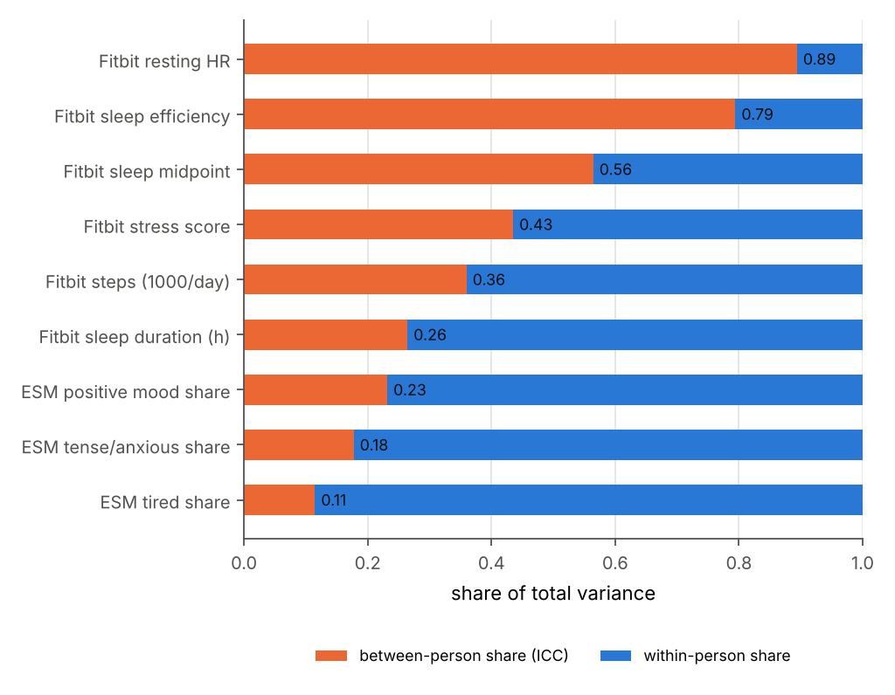
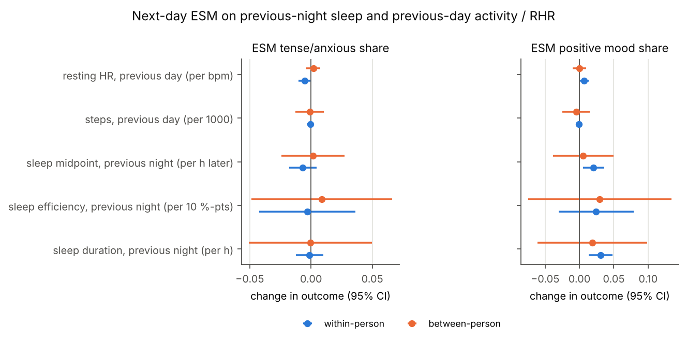
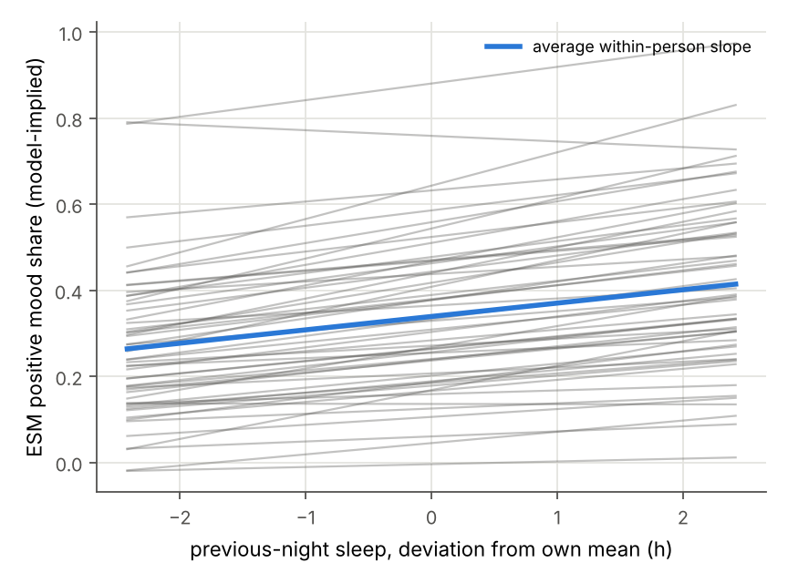
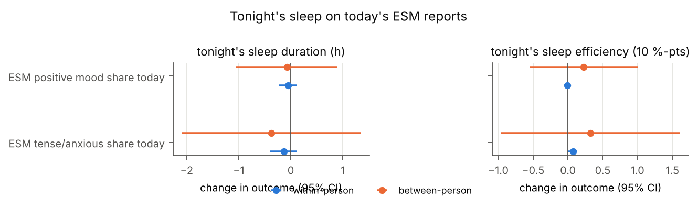
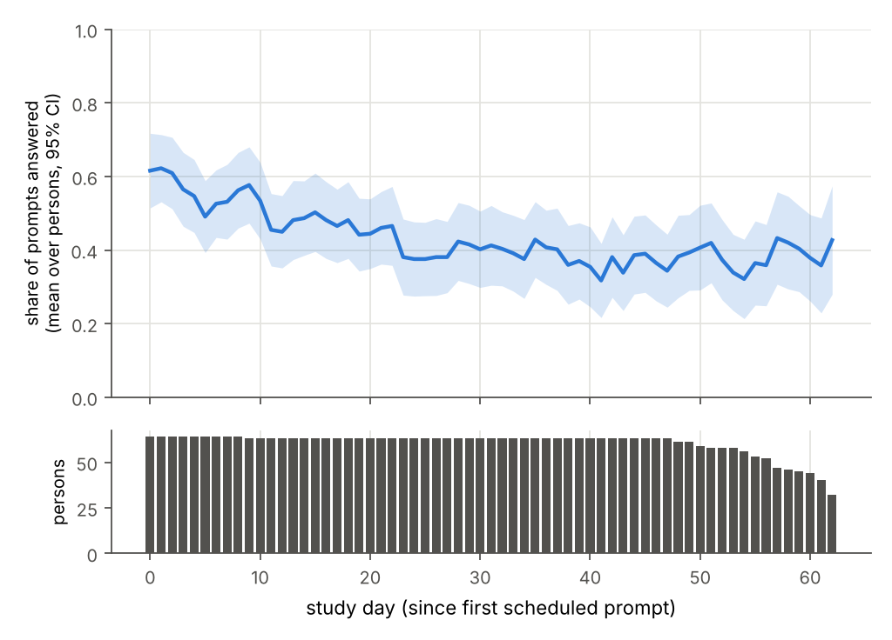

# lifesnaps-multilevel

Within- and between-person effects of sleep, activity and heart rate on daily stress and mood: multilevel models on LifeSnaps.

`dailyml` is a small Python package plus a reproducible analysis. It joins day-level Fitbit data with experience-sampling (ESM / EMA) reports from the public **LifeSnaps** dataset and fits multilevel models that separate two questions:

- **Within person:** "On nights when I sleep *less than my own usual*, do I report more stress the next day?"
- **Between person:** "Do people who *generally* sleep less report more stress?"

The two can differ in size and even in sign. Mixing them in a single slope gives an estimate that answers neither question (Curran & Bauer, 2011). The repository also treats missing ESM responses as an outcome in their own right: who answers prompts, and when?

Every number below comes from `python scripts/run_all.py` on the real data (tables in [`results/`](results/)). The test suite uses synthetic data only.

---

## 1. Dataset (as verified)

| Item | What I found | Where verified |
|---|---|---|
| Reference | Yfantidou S. et al. (2022). LifeSnaps, a 4-month multi-modal dataset capturing unobtrusive snapshots of our lives in the wild. *Scientific Data* 9, 663. doi:10.1038/s41597-022-01764-x | Crossref metadata; article PDF deposited on Zenodo (record 8084982, same DOI) |
| Data record | Zenodo record 7229547 (version 4, the latest), file `rais_anonymized.zip`, 615 MB, MD5 checked by the download script | Zenodo API |
| **Licence** | **CC-BY-4.0**. The paper adds a code of conduct: no re-identification attempts, keep the data confidential, no advertising or re-contacting participants, report misuse, cite the paper | Zenodo API `license.id`; paper "Usage Notes" |
| Participants | 71 who completed the study (77 recruited; 4 dropped out, 1 had an export failure, 1 withdrew consent). Countries: Sweden 24, Italy 10, Greece 25, Cyprus 12. Gender 42 M / 29 F | paper, "Participants" |
| Study length | Two rounds: 24 May – 26 Jul 2021 (n = 38) and 15 Nov 2021 – 17 Jan 2022 (n = 34). One person took part in both rounds. Each round lasted about 9 weeks; the paper describes 8 weeks of data collection plus setup | paper, "Study Procedure", Fig. 4 |
| Formats | (a) MongoDB BSON dumps `fitbit.bson` (9.7 GB uncompressed), `sema.bson`, `surveys.bson`; (b) CSV exports `daily_fitbit_sema_df_unprocessed.csv` and `hourly_…csv`; (c) `scored_surveys/*.csv` | zip listing |
| Device | Fitbit Sense | paper |
| Fitbit, day level | steps, distance, calories, active and sedentary minutes, time in HR zones, resting HR, sleep (minutes asleep and awake, time in bed, efficiency, stage ratios), Fitbit **Stress Score** (36 users), SpO2, nightly skin temperature, HRV (RMSSD), breathing rate, VO2max. **No readiness score** | daily CSV header; paper Table 2 |
| Fitbit sleep records | `startTime`, `endTime`, `dateOfSleep` (wake date), `mainSleep`, `type` (stages/classic). These are only in the BSON dump, not the CSV | streamed from `fitbit.bson` |
| ESM (SEMA3 app) | **Context and Mood Survey**, three times a day (morning, afternoon, evening). It has one single-choice **MOOD** item (happy, rested/relaxed, tense/anxious, tired, alert, sad, and neutral, which was added early in round 1) and one PLACE item. **Step Goal Survey** once each morning. Records carry `SCHEDULED_TS`, `STARTED_TS`, `COMPLETED_TS` and `EXPIRED_TS`. Prompts expire after ≤ 4 h (observed). There is **no numeric stress or mood rating scale** | paper "Data Acquisition"; `sema.bson` |
| Questionnaires | Entry: IPIP-50 Big Five. Entry and exit: TTM stages/processes, BREQ-2. **Weekly**: PANAS and **S-STAI** (the state form, "how you feel right now"). Trait STAI was **not** administered, although the paper's Table 2 describes S-STAI as assessing "trait anxiety". Demographics and PAR-Q are not released | paper; Zenodo description; `scored_surveys/` |
| Time zones | Everything is stored in local time. The authors converted UTC-exported types using each participant's Fitbit-profile time zone. About 3 % of participants travelled across time zones for short periods, and this cannot be detected | paper, "Time Zone Conversion", "Limitations" |

What is downloaded: `scripts/download_data.py` fetches the zip into the git-ignored `data/` folder. It checks the licence and MD5, then extracts the two CSVs, the scored surveys and `sema.bson` (11 MB). The script never extracts `fitbit.bson`. `dailyml.io.extract_sleep_sessions` streams that file once from inside the zip and decodes only the ~4k `sleep` documents with `pymongo`'s `bson` module, so no database server is needed. That pass takes about 2.5 min. No raw data, per-day rows or participant IDs are committed. `results/` holds only aggregates.

---

## 2. Package

```
src/dailyml/
  io.py          loaders -> tidy person-day table + participant table (alignment rules in the docstring)
  prep.py        valid-day rules, person-mean centring, gap-safe lags/leads, calendar completion
  models.py      MixedLM wrapper (multi-optimiser, random-slope fallback), ICC, LRT for random slopes,
                 residual lag-1 autocorrelation, GEE (exchangeable / AR / independence), VB mixed logit,
                 Rubin pooling, Benjamini-Hochberg
  compliance.py  ESM compliance per person / per day / per study day
  plots.py       figures (no IDs)
scripts/download_data.py, scripts/run_all.py
tests/           synthetic-data tests (pytest), run in GitHub Actions on Python 3.11 and 3.12
```

```bash
python -m venv .venv
```

```bash
source .venv/bin/activate
```

```bash
pip install -e ".[dev,data]"
```

```bash
pytest
```

```bash
python scripts/download_data.py
```

```bash
python scripts/run_all.py
```

The `data` extra installs `pymongo`, whose `bson` module is needed only to read the real data, not for the tests. `run_all.py` takes about 2–3 min after the one-off sleep extraction. Re-runs give identical tables (the MI uses a seeded generator), apart from last-digit floating-point differences in the variational-Bayes fits.

---

## 3. Methods

### 3.1 Alignment rules (person-day table)

- **Unit:** one row per participant × local calendar date. Within each person's ESM period (first to last scheduled prompt), every calendar day gets a row. Days with no record are inserted as empty rows, so gaps are explicit.
- **Night to day:** a main sleep belongs to the date on which it **ends**, i.e. Fitbit's `dateOfSleep`. Row *d* therefore holds "the night before day *d*" (`sleep_*`), and "tonight" is the lead (`sleep_*_lead1`). Check on the real data: the release's daily CSV puts `minutesAsleep` on the same date for **100 %** of the 3,551 nights, and 0.4 % match when shifted by one day. Naps (`mainSleep == False`) are ignored. If two main sleeps end on the same date, the longer one is kept.
- **Sleep timing:** onset and midpoint are measured in hours from the previous midnight (23:30 → 23.5, 01:00 → 25.0).
- **ESM:** a prompt belongs to the local date of `SCHEDULED_TS`, its delivery time. *Answered* means `COMPLETED_TS` is not null. The median answer latency is 28 min.
  - 52 prompts scheduled between 00:00 and 04:00 are dropped.
  - 8 answers carry labels outside the app's option list ("JOY", "FEAR", …). They count as answered, but their mood is missing.
- **Daily ESM outcomes:** each is a share of the day's answered mood prompts (mean 2.2 answered per ESM day). Days with no answered prompt are **missing, not zero**.
  - `esm_stress`: share reporting TENSE/ANXIOUS.
  - `esm_positive`: share reporting HAPPY or RESTED/RELAXED.
  - `esm_tired`: share reporting TIRED (secondary).
- **Temporal order in the main model:** sleep is the night before day *d*. Steps and resting HR are from **day *d − 1*** (`*_lag1`), so all predictors come before the ESM reports.
- **Study time** is counted within round (`study_week` = days since the person's first ESM day in that round ÷ 7), because one participant took part in both rounds. Two participants started in late April 2021, so their ESM periods last 89–94 days.

### 3.2 Valid-day rules (`prep.ValidDayRules`)

| Rule | Threshold | Rationale |
|---|---|---|
| Valid wear day | ≥ 10 clock hours containing a heart-rate value **and** ≥ 100 steps | Conventional ≥ 10 h accelerometry rule (Troiano et al., 2008). LifeSnaps exports no wear flag, so optical HR presence stands in for wear. Steps and resting HR are blanked on other days |
| Valid night | 180–900 min asleep (main sleep) | removes nap-like or artefactual main-sleep records |
| Fitbit stress score | 0 set to missing | the paper notes that 0 is an out-of-range artefact |
| Strict variant (robustness) | ≥ 16 h worn, 240–720 min asleep | |

### 3.3 Within/between decomposition

For a time-varying predictor $x_{ij}$ (day $i$, person $j$):

$$\bar x_j = \text{mean of } x_{ij} \text{ over person } j\text{'s valid days},\qquad x^{W}_{ij} = x_{ij}-\bar x_j,\qquad x^{B}_j = \bar x_j - \tfrac{1}{J}\textstyle\sum_{j'}\bar x_{j'}$$

Person means are taken over **all** of the person's valid days in their ESM period, not only days with an ESM answer. This gives a better estimate of their "usual". The grand mean weights each person equally. The tests check that the decomposition recovers known within (−0.5) and between (+1.5) slopes on simulated data, while a pooled regression on raw $x$ does not.

Lags are calendar merges (`x_lag1` on day $d$ = value on day $d-1$, else missing), so a lag **never bridges a missing day**. There are tests for this.

### 3.4 Models

**Main model** (`statsmodels.MixedLM`, REML), for each ESM outcome $y$:

$$
\begin{aligned}
y_{ij} = {}&\gamma_{00} + \gamma_{10}\,\text{sleep}^{W}_{ij} + \gamma_{20}\,\text{eff}^{W}_{ij} + \gamma_{30}\,\text{mid}^{W}_{ij} + \gamma_{40}\,\text{steps}^{W}_{i-1,j} + \gamma_{50}\,\text{RHR}^{W}_{i-1,j} \\
&+ \gamma_{01}\,\text{sleep}^{B}_{j} + \gamma_{02}\,\text{eff}^{B}_{j} + \gamma_{03}\,\text{mid}^{B}_{j} + \gamma_{04}\,\text{steps}^{B}_{j} + \gamma_{05}\,\text{RHR}^{B}_{j} \\
&+ \gamma_{60}\,\text{weekend}_{ij} + \gamma_{70}\,\text{week}_{ij} + u_{0j} + u_{1j}\,\text{sleep}^{W}_{ij} + e_{ij},
\end{aligned}
$$

with $(u_{0j},u_{1j}) \sim N(0, \mathbf T)$ and $e_{ij}\sim N(0,\sigma^2)$. Units: sleep duration per hour, efficiency per 10 percentage points, midpoint per hour later, steps per 1,000, resting HR per bpm.

- **Random slope** for within-person sleep duration. A REML likelihood-ratio test compares it with a random-intercept model, using a 50:50 χ²(1)/χ²(2) mixture p value (Stram & Lee, 1994).
- **Automatic fallback:** if the slope model fails to converge, puts the slope variance at 0, or gives a singular random-effects covariance (|corr| > 0.98), the code refits with a random intercept only and records the reason.
- **Optimisers:** each model is fitted with BFGS, L-BFGS and Powell, and the converged fit with the highest likelihood is kept. L-BFGS alone returned τ = 0 on data where τ is clearly > 0.

**What `statsmodels` cannot do, and what I used instead:**

- *No residual AR(1) structure in MixedLM.* I report the lag-1 autocorrelation of level-1 residuals on consecutive days and run two sensitivity analyses: (i) adding the person-centred lagged outcome $y^{W}_{i-1,j}$, and (ii) a population-averaged GEE with an autoregressive working correlation over study day (`Autoregressive(grid=False)`, so gaps reduce the assumed correlation).
- *No frequentist mixed-effects logistic model.*
  - Binary outcomes (prompt answered; prompt-level mood) use **GEE** with a logit link and cluster-robust SEs (Liang & Zeger, 1986). These give population-averaged effects.
  - **`BinomialBayesMixedGLM`** (random-intercept logit, variational Bayes) serves as a conditional-model check. Its posterior SDs are known to be too narrow, so I read only its point estimates.
  - For compliance, the exchangeable GEE update diverged because several people answered almost no prompts, so those GEEs use an independence working correlation. The cluster-robust SEs remain valid.
- *Ordinal outcome:* not needed, because the ESM item is nominal single-choice and the outcomes are daily shares.

**Reverse direction:** tonight's sleep (`sleep_h_lead1`) is regressed on today's ESM share, split into within- and between-person parts, plus:

- last night's sleep, within-person deviation only (a lagged outcome). Its person mean is almost the person mean of the outcome itself, and including it would absorb all between-person variance;
- same-day steps (within and between);
- Friday/Saturday night;
- study week.

A random slope for the ESM term was tried and dropped as singular (see `results/model_info.json`).

**Cross-level moderation:** the main model plus $Z_j$ and $\text{sleep}^W_{ij}\times Z_j$, where $Z_j$ is (a) IPIP neuroticism, i.e. negated Emotional Stability, z-scored across participants (the pre-specified test), or (b) the person's mean weekly S-STAI, a trait-like summary of a state measure. The random slope is kept, as recommended for cross-level interactions (Heisig & Schaeffer, 2019).

**Compliance model** (prompt level, $n$ = 11,348 prompts):

$$\text{logit}\,P(\text{answered}_{pij}) = \beta_0 + \beta_1\,\text{wear}^{W}_{i-1,j} + \beta_2\,\text{wear}^{B}_j + \beta_3\,\text{weekend} + \beta_4\,\text{week} + \beta_5\,\text{afternoon} + \beta_6\,\text{evening}\;[+\ \text{steps}^{W/B}_{i-1},\ \text{sleep}^{W/B}_{i}]$$

Wear is measured in units of 4 h of previous-day wear time. Model B adds previous-day steps and last night's sleep, so it is restricted to prompts on days where those values are valid.

**Missing data:**

- The primary analyses are complete-case on predictors. MixedLM uses every available day, so the outcome is assumed missing at random given the predictors and the person's random effects.
- Sensitivity analysis: missing raw predictors on ESM days are imputed **20 times** by chained equations with predictive mean matching (`statsmodels` `MICEData`). The imputation model includes the outcome, weekend, study week and each person's observed mean of every predictor. This is a single-level approximation to a multilevel imputation model. The decomposition is recomputed in each imputed dataset, and estimates are pooled with Rubin's rules.

**Multiple testing:** Benjamini–Hochberg FDR control is applied over a pre-specified confirmatory family of 13 tests: the 5 within-person terms in each main model (stress, positive mood), the within-person ESM term in each reverse model, and the sleep × neuroticism interaction for stress. These have $q$ values in `results/all_fixed_effects.csv`. Everything else (tiredness, efficiency, between-person terms, S-STAI moderation, robustness checks) is exploratory and uncorrected.

---

## 4. Results (actual run)

### 4.1 Descriptives (`results/descriptives.csv`, `compliance_distribution.csv`)

| Quantity | Value |
|---|---|
| Participants in the Fitbit daily CSV / with ESM prompts | 71 / 63 |
| Person-days in ESM periods | 3,986 |
| Valid wear days / valid main-sleep nights | 2,840 / 2,308 |
| Mood prompts scheduled / answered | 11,474 / 5,034 → **pooled compliance 43.9 %** |
| Per-person compliance: mean (SD), median [IQR] | 43.5 % (33.6), 41.2 % [11.1 – 80.8 %] |
| Persons with ≥ 75 % / < 25 % compliance | 28.6 % / 39.7 % |
| Days with ≥ 1 answered mood prompt | 2,283 (63 persons; median 40 days per person) |
| Mean ESM shares on answered days | tense/anxious 0.13, positive 0.40, tired 0.22 |
| Mean sleep / steps / resting HR on valid days | 6.72 h / 8,883 / 65.6 bpm |

Per-person compliance is **bimodal**: 15 of 63 people answered ≤ 10 % of prompts and 17 answered > 80 %.



**ICC** (`results/icc.csv`). The intercept-only model gives the share of variance that lies between persons:

| Variable | ICC |
|---|---|
| ESM tense/anxious share | 0.18 |
| ESM positive share | 0.23 |
| ESM tired share | 0.11 |
| Sleep duration | 0.26 |
| Sleep midpoint | 0.56 |
| Sleep efficiency | 0.79 |
| Steps | 0.36 |
| Resting HR | 0.89 |
| Fitbit stress score | 0.43 |

**Interpretation:** 77–89 % of the variance in daily ESM reports is *within* persons, i.e. day-to-day fluctuation. Resting HR and Fitbit sleep efficiency are mostly stable traits of the person or device. Within-person variation in efficiency is small (SD ≈ 3 percentage points), so little can be learned about its within-person effect.

### 4.2 Main model: last night's sleep and previous-day activity/RHR → today's ESM

$n$ = 1,649 person-days, 53 persons (`results/main_within_between.csv`). The SD of within-person sleep deviations is 1.21 h, and the SD of person means is 0.86 h.

| Outcome | Term | Within-person, b [95 % CI] | Between-person, b [95 % CI] |
|---|---|---|---|
| **Tense/anxious share** | sleep duration (h) | −0.001 [−0.013, 0.010] | −0.001 [−0.051, 0.050] |
| | sleep midpoint (h later) | −0.007 [−0.018, 0.005] | 0.002 [−0.024, 0.028] |
| | sleep efficiency (10 pp) | −0.003 [−0.042, 0.036] | 0.009 [−0.049, 0.066] |
| | steps prev. day (1,000) | −0.001 [−0.004, 0.002] | −0.001 [−0.013, 0.011] |
| | resting HR prev. day (bpm) | −0.005 [−0.010, −0.000], p = .034, **q = .14** | 0.002 [−0.004, 0.007] |
| **Positive mood share** | sleep duration (h) | **0.031 [0.014, 0.048]**, p = .0005, **q = .006** | 0.019 [−0.061, 0.099] |
| | sleep midpoint (h later) | 0.021 [0.005, 0.036], p = .009, q = .061 | 0.005 [−0.039, 0.050] |
| | sleep efficiency (10 pp) | 0.024 [−0.030, 0.079] | 0.030 [−0.075, 0.134] |
| | steps prev. day (1,000) | −0.001 [−0.005, 0.003] | −0.005 [−0.025, 0.015] |
| | resting HR prev. day (bpm) | 0.007 [0.000, 0.014], p = .046, q = .14 | −0.000 [−0.010, 0.009] |
| *Tired share (secondary)* | sleep duration (h) | **−0.033 [−0.050, −0.016]** | −0.001 [−0.043, 0.042] |
| | steps prev. day (1,000) | 0.004 [0.000, 0.007] | −0.002 [−0.013, 0.009] |
| | sleep efficiency (10 pp) | −0.025 [−0.072, 0.023] | −0.050 [−0.099, −0.001] |

Weekend and study-week coefficients are in `results/all_fixed_effects.csv`.



**Random slopes** (`results/random_slope_tests.csv`, within-person sleep slope):

| Outcome | Slope SD | LRT p |
|---|---|---|
| Stress | 0.015 | .45 (no evidence that people differ) |
| Positive mood | 0.033 | .013 |
| Tiredness | 0.037 | < .001 |

For positive mood, the fixed slope is 0.031 and the slope SD is 0.033, so a person 1 SD below the average slope would have roughly no sleep–mood link.



The spaghetti plot shows model-implied linear lines per person, without IDs and in random order. Lines can leave [0, 1] because the model is linear.

**In plain language:**

- **Positive mood:** on nights when someone slept an hour more than *their own* average, the share of their next-day mood reports that were "happy" or "rested/relaxed" was about 3 percentage points higher, against a base of about 40 %. That is small, but it survives FDR correction and all robustness checks below. People who *generally* sleep longer did not report more positive mood (between-person estimate 0.02, CI −0.06 to 0.10). Here the between-person CI is about five times wider than the within-person CI. With 53 people, the study has far more information about day-to-day change than about differences between people.
- **Tense/anxious mood:** neither within-person sleep (b = −0.001, CI ±0.011) nor between-person sleep (b = −0.001, CI ±0.05) predicted it. On a base of 13 %, the within-person CI rules out effects larger than about 1 percentage point per hour of sleep.
- **Tiredness:** this is the most direct check that the variables mean what they should. Sleeping an hour less than usual raised the share of "tired" reports by 3.3 percentage points.
- **Resting HR:** the previous-day within-person RHR effects on stress (−) and positive mood (+) are nominal only (q = .14) and go in the opposite direction from a "physiological stress" reading. I do not interpret them.

**Autocorrelation** (`results/autocorrelation.csv`):

| Outcome | Residual lag-1 r [95 % CI] |
|---|---|
| Stress | 0.09 [0.04, 0.14] |
| Positive | 0.16 [0.11, 0.21] |
| Tired | 0.10 [0.05, 0.15] |

- Adding the person-centred lagged outcome brings the residual autocorrelation to ≈ 0 (−0.02 to 0.01). The sleep → positive-mood effect barely changes: 0.028 [0.011, 0.045].
- The GEE with AR(1) working correlation gives 0.022 [0.003, 0.042].
- The lagged-outcome coefficients themselves are 0.10 (stress) and 0.14 (positive). There is modest emotional inertia, and its estimate is biased downward in fixed-effect-style models when the number of days is small (Nickell, 1981).

### 4.3 Reverse direction: today's ESM → tonight's sleep

$n$ = 1,515 nights, 53 persons (`results/reverse_within_between.csv`). The ESM predictor is a share from 0 to 1, so the coefficient is the change for a day with *all* prompts in that category versus none. The within-person SD of the share is 0.25 for tense/anxious and 0.36 for positive.

| Today | Tonight | Within, b [95 % CI] | Between, b [95 % CI] |
|---|---|---|---|
| tense/anxious share | sleep duration (h) | −0.14 [−0.39, 0.12], q = .54 | −0.38 [−2.09, 1.34] |
| positive share | sleep duration (h) | −0.05 [−0.23, 0.12], q = .78 | −0.07 [−1.05, 0.90] |
| tense/anxious share | efficiency (10 pp) | 0.07 [0.01, 0.14], p = .027 (exploratory) | 0.32 [−0.96, 1.60] |
| positive share | efficiency (10 pp) | −0.01 [−0.06, 0.04] | 0.23 [−0.55, 1.00] |

There is **no evidence of an ESM → sleep-duration path**. The one nominal efficiency effect is tiny: about 0.2 percentage points of efficiency for a 0.25 change in the share. It is uncorrected and goes in an implausible direction (more tension, higher efficiency), so I treat it as noise. Friday/Saturday nights were 0.21 h [0.07, 0.35] longer. Random slopes for the ESM terms were singular (|corr| = 1.00) and were dropped automatically.



### 4.4 Cross-level moderation (`results/moderation.csv`)

| Moderator (z) | Outcome | Main effect of moderator | sleep^W × moderator | n days / persons |
|---|---|---|---|---|
| IPIP neuroticism | tense/anxious | 0.029 [−0.011, 0.069] | **−0.011 [−0.021, 0.000]**, p = .055, q = .14 | 1,394 / 44 |
| IPIP neuroticism | positive | −0.053 [−0.123, 0.017] | 0.001 [−0.018, 0.019] | 1,394 / 44 |
| mean weekly S-STAI | tense/anxious | **0.050 [0.018, 0.082]** | −0.004 [−0.016, 0.008] | 1,485 / 47 |
| mean weekly S-STAI | positive | −0.018 [−0.085, 0.049] | 0.003 [−0.013, 0.020] | 1,485 / 47 |

- **Neuroticism:** there is a weak hint that more neurotic people report less tension after sleeping more than usual (−1 percentage point per hour per SD of neuroticism). It is not significant after correction, and the random-slope variance it would explain is estimated at about 0. It is a hypothesis for a larger sample, not a finding.
- **S-STAI:** people with higher mean weekly S-STAI chose "tense/anxious" more often: +5 percentage points per SD. This is a convergent-validity check for the single ESM item, not a moderation result.

### 4.5 ESM compliance (`results/compliance_models.csv`, `compliance_by_study_day.csv`)



Mean daily compliance by study week (weeks 0–8): 0.57, 0.51, 0.47, 0.40, 0.40, 0.38, 0.37, 0.37, 0.40. After day 62, fewer than 11 persons contribute; only the two April starters run beyond day 64. The tail is not interpreted, and the figure shows only days with ≥ 20 persons.

GEE logit with an independence working correlation and robust SEs. Model A uses 11,348 prompts from 63 persons. Odds ratios:

| Predictor | OR [95 % CI] |
|---|---|
| previous-day wear, +4 h vs own usual (within) | **1.14 [1.05, 1.23]** |
| usual wear, +4 h (between) | **1.57 [1.24, 1.99]** |
| weekend | 0.87 [0.79, 0.95] |
| afternoon vs morning prompt | 0.73 [0.65, 0.83] |
| evening vs morning prompt | 0.55 [0.47, 0.64] |
| study week | 0.94 [0.88, 1.01] |

The random-intercept VB logit gives the same directions with larger magnitudes (within-person wear OR 1.21, study week OR 0.83), as expected for conditional versus population-averaged effects. Its person-intercept SD is 2.0 on the logit scale, which is a very large between-person difference in responding.

Model B adds activity and sleep and is restricted to valid days (6,629 prompts, 56 persons). Previous-day steps do not predict answering (OR 1.00 per 1,000, both within and between). A night with 1 h more sleep than usual gives OR 1.05 [1.01, 1.09]. Within-person wear stops predicting answering in this subset, OR 0.97 [0.82, 1.14], because model B by construction contains only days the watch was worn.

**In plain language:** non-response is mostly a property of the *person*. A person who wears the watch 4 h more per day on average has about 1.6× the odds of answering. On top of that, there is a day-level signal that a monitoring system could use: on days after the watch was worn less than usual, the person is also less likely to answer prompts. Evening and weekend prompts are answered least, and compliance drops from 57 % to about 40 % over the first three weeks. These are the ingredients of a simple "predicting non-adherence" rule: flag a person when wearable wear time drops below their own baseline. The rule has not been tested prospectively.

### 4.6 Robustness (`results/robustness.csv`, `prompt_level_logit.csv`)

Within-person effect of last night's sleep (per hour) under each variant:

| Variant | Tense/anxious | Positive | n / persons |
|---|---|---|---|
| main (complete case) | −0.001 [−0.013, 0.010] | 0.031 [0.014, 0.048] | 1,649 / 53 |
| sleep + steps only (no efficiency, timing, RHR) | −0.001 [−0.012, 0.011] | 0.030 [0.012, 0.047] | 1,661 / 53 |
| sleep = time in bed | −0.000 [−0.010, 0.010] | 0.025 [0.010, 0.040] | 1,654 / 53 |
| only "stages" sleep records | −0.002 [−0.015, 0.011] | 0.032 [0.014, 0.050] | 1,613 / 52 |
| strict rules (wear ≥ 16 h, sleep 4–12 h) | −0.000 [−0.015, 0.015] | 0.032 [0.010, 0.053] | 1,510 / 52 |
| exclude persons < 30 % compliance | 0.000 [−0.012, 0.012] | 0.027 [0.009, 0.045] | 1,472 / 35 |
| days with ≥ 2 answered prompts | −0.001 [−0.010, 0.009] | 0.024 [0.005, 0.042] | 1,307 / 51 |
| GEE AR(1) working correlation | 0.000 [−0.009, 0.009] | 0.022 [0.003, 0.042] | 1,649 / 53 |
| multiple imputation of predictors (m = 20) | −0.000 [−0.011, 0.010] | 0.030 [0.016, 0.044] | 2,283 / 63 |
| prompt-level GEE logit (OR per h) | 1.00 [0.92, 1.08] | **1.12 [1.03, 1.22]** | 3,787 prompts / 53 |

The conclusions do not change under any variant: there is a small within-person sleep → positive-mood effect and no sleep → tension effect.

### 4.7 Comparison with the LifeSnaps paper

The paper is a data descriptor. It reports **no inferential analyses** of sleep, activity and mood, so there is nothing to replicate on that front. Its descriptive figures compare as follows:

| Paper | This analysis |
|---|---|
| SEMA3 average compliance 43 % ("calculated from the SEMA3 online platform") | 43.9 % pooled (5,034 / 11,474). Before dropping prompts scheduled 00:00–04:00 it is 5,037 / 11,526 = 43.7 % |
| "nearly 1 in 3 participants replied to more than 75 % of the EMA surveys" | 18 / 63 = 28.6 % with ≥ 75 % |
| Context and Mood Survey: 63 users, 11,526 responses | 63 user IDs, 11,526 records. The paper's "responses" are scheduled records; 5,037 are completed |
| Step Goal Survey: 61 users, 3,852 responses | 3,852 records from 63 user IDs. I did not check how the paper counted users |
| IPIP 52, PANAS 53 (302), S-STAI 55 (314) users (responses) | scored CSVs: IPIP 50, PANAS 51 (268), S-STAI 53 (279). The scored files have fewer rows than the raw survey counts; the reason is not documented and was not verified |
| ~18 % drop in SEMA3 compliance across the study | 57 % in week 0 → 37–40 % in weeks 5–8 |
| Fitbit engagement: mean 41.37 days | not recomputed, because the paper's definition of an "engagement day" is not stated precisely |

---

## 5. Interpretation and limitations

- **Observational.** Within-person associations remove stable confounders such as personality, chronotype and device fit, because each person is compared with themselves. They do not remove time-varying confounders: a late party causes both short sleep and a happy morning, and illness causes both. They are not causal effects.
- **Self-selected, small sample.** Participants were 71 university-linked volunteers from four European countries, with mostly Master's-level education, during COVID-19 restrictions. Between-person estimates rest on only 44–53 people and are imprecise.
- **ESM outcomes are single nominal items.** "Tense/anxious" is one option of a forced single choice among seven. A person who is tense *and* tired can only pick one. Daily shares based on 1–3 answers are coarse, so a linear model on a bounded share is an approximation. The prompt-level logit check agrees with it. No validated momentary stress scale was administered.
- **Fitbit sleep is a consumer estimate, not PSG.** Duration and especially efficiency are algorithm outputs: Fitbit efficiency clusters at 93–97 % and has a high ICC. Sleep "stages" versus "classic" records are computed differently.
- **Wear is approximated** by the presence of heart-rate data. Steps and resting HR depend on wear on the day.
- **Missingness is substantial and informative.** Only 1,649 of 2,283 ESM days have complete predictors, and compliance itself depends on wear time and on the person. MI under MAR gives the same answers, but MNAR (e.g. not answering on bad days) cannot be ruled out.
- **Effects are small** (about 3 percentage points per hour of sleep). Practical relevance for a just-in-time intervention is unclear.
- **Multiple testing:** FDR is controlled only within the stated confirmatory family. Other p values are exploratory.
- **Time zones and travel** cannot be detected, which affects about 3 % of participants according to the paper.
- **Model limits:** `statsmodels` has no AR(1) residual structure and no frequentist GLMM. The workarounds are listed in §3.4. VB intervals are too narrow and should not be read as CIs.

---

## 6. Modelling choices worth reviewing

1. The ESM outcome definitions: stress = TENSE/ANXIOUS share; positive = HAPPY + RESTED/RELAXED. NEUTRAL and ALERT count as neither.
2. Person means are computed over all valid days in the ESM period, not only the analysed days.
3. Predictor timing: activity and RHR use the previous day rather than the same day.
4. The ≥ 10 h HR-wear rule and the 3–15 h sleep range.
5. A linear mixed model on daily shares rather than a binomial GLMM, for which there is no frequentist option in `statsmodels`.
6. Independence working correlation in the compliance GEEs (the exchangeable update diverged).
7. Neuroticism (IPIP) as the trait moderator, because trait STAI is not available.
8. The 13-test confirmatory family for the FDR correction.

---

## 7. References

All references were verified against Crossref metadata, or for the dataset, against the Zenodo API.

- Benjamini, Y., & Hochberg, Y. (1995). Controlling the false discovery rate: a practical and powerful approach to multiple testing. *Journal of the Royal Statistical Society: Series B*, 57(1), 289–300. doi:10.1111/j.2517-6161.1995.tb02031.x
- Curran, P. J., & Bauer, D. J. (2011). The disaggregation of within-person and between-person effects in longitudinal models of change. *Annual Review of Psychology*, 62, 583–619. doi:10.1146/annurev.psych.093008.100356
- Enders, C. K., & Tofighi, D. (2007). Centering predictor variables in cross-sectional multilevel models: a new look at an old issue. *Psychological Methods*, 12(2), 121–138. doi:10.1037/1082-989X.12.2.121
- Hamaker, E. L., & Grasman, R. P. P. P. (2015). To center or not to center? Investigating inertia with a multilevel autoregressive model. *Frontiers in Psychology*, 5, 1492. doi:10.3389/fpsyg.2014.01492
- Heisig, J. P., & Schaeffer, M. (2019). Why you should *always* include a random slope for the lower-level variable involved in a cross-level interaction. *European Sociological Review*, 35(2), 258–279. doi:10.1093/esr/jcy053
- Liang, K.-Y., & Zeger, S. L. (1986). Longitudinal data analysis using generalized linear models. *Biometrika*, 73(1), 13–22. doi:10.1093/biomet/73.1.13
- Nickell, S. (1981). Biases in dynamic models with fixed effects. *Econometrica*, 49(6), 1417–1426. doi:10.2307/1911408
- Rubin, D. B. (1987). *Multiple Imputation for Nonresponse in Surveys*. Wiley. (Book; cited for the pooling rules.)
- Stram, D. O., & Lee, J. W. (1994). Variance components testing in the longitudinal mixed effects model. *Biometrics*, 50(4), 1171–1177. doi:10.2307/2533455
- Troiano, R. P., Berrigan, D., Dodd, K. W., Mâsse, L. C., Tilert, T., & McDowell, M. (2008). Physical activity in the United States measured by accelerometer. *Medicine & Science in Sports & Exercise*, 40(1), 181–188. doi:10.1249/mss.0b013e31815a51b3
- Yfantidou, S., Karagianni, C., Efstathiou, S., Vakali, A., Palotti, J., Giakatos, D. P., Marchioro, T., Kazlouski, A., Ferrari, E., & Girdzijauskas, Š. (2022). LifeSnaps, a 4-month multi-modal dataset capturing unobtrusive snapshots of our lives in the wild. *Scientific Data*, 9, 663. doi:10.1038/s41597-022-01764-x. Data: Zenodo record 7229547 (v4).

## 8. Licence

- **Code:** MIT, © lizxu-byte (see `LICENSE`).
- **Data:** LifeSnaps is © its authors and licensed **CC-BY-4.0**. It is not redistributed here and is downloaded from Zenodo by the script. Use of the data should follow the authors' code of conduct (paper, "Usage Notes"), including never attempting to re-identify participants.
- **Outputs:** `results/` contains only aggregated tables and figures derived from the data. They carry no participant identifiers and no per-day rows, and are shared under the same attribution requirement (cite Yfantidou et al., 2022).
